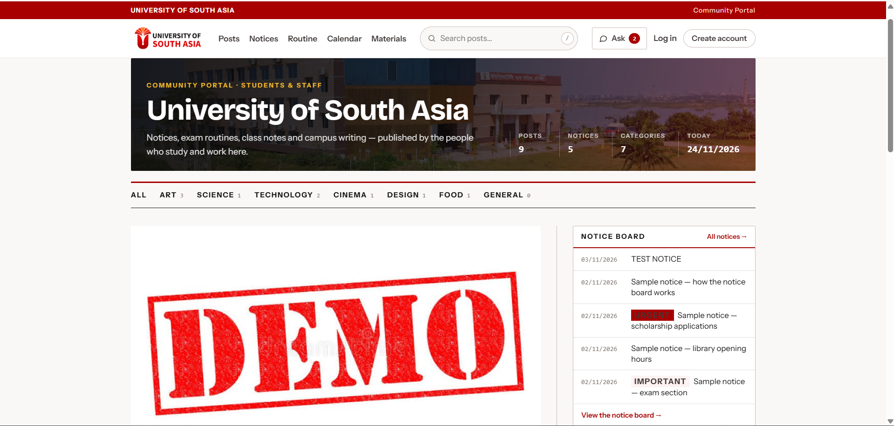

# University of South Asia — Community Portal

A full-stack campus community portal: **React 18 + Vite** on the front, **Express + MySQL** behind, with JWT sessions held in an **httpOnly cookie**.

Students and staff publish class notes, project write-ups and study materials; staff post official **notices**, **exam routines** and **academic-calendar** entries; and everyone can **rate, comment on and discuss** posts and ask **questions** in the community Q&A.



---

## Stack

| Layer | Choice |
|---|---|
| Frontend | React 18, Vite 6, React Router 6.4 (`createBrowserRouter`), SCSS, react-quill, DOMPurify, axios, moment, Fontsource |
| Backend | Node ESM, Express 4, mysql2 (connection pool), bcryptjs, jsonwebtoken, zod, multer, sanitize-html, express-rate-limit |
| Database | MySQL 8.4 |
| Auth | bcrypt (cost 12) + JWT in an `httpOnly`, `sameSite=lax` cookie |

---

## Features

- **Posts** — rich-text write-ups with a cover image, per-category browsing, search, sort by latest/top, view counting.
- **Ratings** — one 1–5 rating per member per post (authors cannot rate their own).
- **Comments** — one level of replies, plus up/down votes.
- **Notices** — staff-only board with categories (general, exam, admission, result, event, scholarship), priority, pinning and auto-expiry.
- **Exam routines** — the official PDF plus metadata, filtered by department, semester and exam type.
- **Academic calendar** — events, holidays, exam weeks and deadlines in one table, with a featured flag.
- **Study materials** — community-contributed notes, slides, past papers and syllabi with download counts.
- **Q&A** — questions with answers, an accepted answer, and an "unanswered" count in the navbar.
- **Admin area** — dashboard tiles, user approval/suspension/role management, categories and departments, notices, routines, events and materials, and an audit log.
- **Roles** — `user`, `moderator`, `admin`, with an approval flow (`pending` → `active` → `suspended`).

---

## Prerequisites

- **Node.js 18+**
- A reachable **MySQL 8**

---

## Quick start

```bash
npm install          # installs both workspaces (backend + frontend)
cp src/backend/.env.example src/backend/.env   # then set JWT_SECRET
npm run db:init      # creates the schema, applies migrations, seeds demo data
npm run dev          # API on :8800, Vite on :5173
```

Then open **http://localhost:5173**.

The defaults in `src/backend/.env.example` expect MySQL on `127.0.0.1:3307`. Point `DB_HOST` / `DB_PORT` at your own server if it lives elsewhere. Vite proxies `/api` and `/uploads` to `:8800`, so the browser only ever talks to `:5173`.

### Seeded accounts

These accounts ship with the project — the seed script creates them, and the same four are present in the included `db/campus-community.sql` backup. All are already approved.

| Username | Password | Role |
|---|---|---|
| `admin` | `Admin@123` | admin |
| `moderator` | `Moderator@123` | moderator |
| `demo` | `password123` | user |
| `writer` | `password123` | user |

**New registrations are `pending`** and must be approved by a moderator or admin before they can log in.

### Restoring from the included backup

`db/campus-community.sql` is a full schema + data dump (18 tables, matching migrations `001`–`005`). Restore it into a running MySQL without touching the app code:

```bash
# create the database if it does not exist (the hyphen needs backticks in SQL)
mysql -h 127.0.0.1 -P 3307 -uroot -p \
  -e "CREATE DATABASE IF NOT EXISTS \`campus-community\` CHARACTER SET utf8mb4 COLLATE utf8mb4_unicode_ci;"

# import the dump into it
mysql -h 127.0.0.1 -P 3307 -uroot -p --default-character-set=utf8mb4 \
  campus-community < db/campus-community.sql
```

Adjust the host, port and credentials to match your own MySQL. The app already points at `DB_NAME=campus-community` on `127.0.0.1:3307`, so once the dump is imported, `npm run dev` serves this data as-is.

---

## Configuration

Copy `src/backend/.env.example` to `src/backend/.env`. All secrets live there (gitignored).

| Variable | Default | Notes |
|---|---|---|
| `NODE_ENV` | `development` | |
| `PORT` | `8800` | API port |
| `CLIENT_ORIGIN` | `http://localhost:5173` | CORS allow-list |
| `DB_HOST` / `DB_PORT` | `127.0.0.1` / `3307` | |
| `DB_USER` / `DB_PASSWORD` | `root` / `root` | |
| `DB_NAME` | `campus-community` | created/used by the app |
| `DB_AUTO_MIGRATE` | `true` | apply migrations on boot; run `npm run db:migrate` explicitly in production |
| `JWT_SECRET` | — | **required**; startup fails loudly without it |
| `JWT_EXPIRES_IN` | `7d` | also sets the cookie `maxAge` |
| `COOKIE_NAME` | `access_token` | |
| `COOKIE_SECURE` | prod defaults to `true` | set `false` when serving over plain HTTP |
| `UPLOAD_MAX_MB` | `5` | per-file limit for images |
| `DOCUMENT_MAX_MB` | `15` | per-file limit for PDFs |
| `AUTH_RATE_LIMIT` | `100` | attempts per window on login/register |
| `AUTH_RATE_WINDOW_MINUTES` | `15` | |

Generate a real secret with:

```bash
node -e "console.log(require('crypto').randomBytes(48).toString('hex'))"
```

---

## Scripts

Run from the repo root:

| Command | Does |
|---|---|
| `npm run dev` | API (nodemon) + Vite together, colour-coded output |
| `npm run dev:api` | API only (`:8800`) |
| `npm run dev:web` | Vite only (`:5173`) |
| `npm run build` | production build of the frontend into `src/frontend/dist` |
| `npm run db:init` | create schema + apply migrations + seed demo data (idempotent) |
| `npm run db:init --workspace src/backend -- --fresh` | **wipe** and reseed |
| `npm run db:migrate` | apply pending SQL migrations only |

Migrations live in `src/backend/db/migrations/` and are tracked in a `schema_migrations` table with checksums — applied files are immutable, so add a new file rather than editing an old one.

---

## Project structure

```
campus-community/
├─ db/campus-community.sql       full schema + data backup (18 tables)
├─ public/                       university logo, favicons, manifest (Vite publicDir)
├─ src/backend/
│  ├─ app.js                     express app: middleware, routes, static /uploads
│  ├─ server.js                  entrypoint: DB ping, migrations, listen, graceful shutdown
│  ├─ config/env.js              loads + validates env (fails fast)
│  ├─ db/pool.js                 mysql2/promise pool + query() helper
│  ├─ db/migrator.js             numbered, checksummed SQL migrations
│  ├─ db/migrations/             001…005 — blog schema → community platform → content hub → Q&A → views
│  ├─ schemas.js                 zod schemas + canonical enums
│  ├─ controllers/               auth, post, rating, comment, category, department,
│  │                             notice, routine, event, material, qa, file, admin
│  ├─ routes/                    one router per resource, mounted under /api
│  ├─ middleware/                requireAuth, authorize, validate, upload, errorHandler, asyncHandler
│  ├─ scripts/init-db.js         schema + migration + seed runner
│  ├─ scripts/migrate.js         migration-only runner
│  ├─ utils/ApiError.js
│  └─ uploads/                   runtime upload target (gitignored)
└─ src/frontend/
   └─ src/
      ├─ App.jsx                 router + RequireAuth guard, lazy /write and /admin
      ├─ api/axios.js            shared instance + error helpers
      ├─ context/authContext.jsx
      ├─ hooks/                  useCategories, useDepartments, useQuestionStats, usePageTitle, useReveal
      ├─ components/             Navbar, Footer, Menu, SearchBox, Comments, RatingPanel, Pager, …
      ├─ pages/                  Home, Posts, Single, Write, Questions, Notices, Routine, Calendar, Materials, Login, Register, Admin
      └─ scss/                   style.scss + partials
```

---

## API

Base URL `http://localhost:8800` (local dev) or `/api` via the web origin. All responses are JSON; errors share the shape `{ "error": { "message": "...", "code": "...", "fields": [...] } }`.

| Method | Path | Auth | Notes |
|---|---|---|---|
| `GET` | `/api/health` | – | liveness |
| `POST` | `/api/auth/register` | – | creates a **pending** account |
| `POST` | `/api/auth/login` | – | sets the `access_token` cookie |
| `POST` | `/api/auth/logout` | – | clears the cookie |
| `GET` | `/api/auth/me` | ✅ | current user (rehydrates the session) |
| `PATCH` | `/api/auth/me` | ✅ | update profile |
| `POST` | `/api/auth/password` | ✅ | change password |
| `GET` | `/api/posts` | – | filters: `category`, `sort`, `q`, `author`, `page`, `pageSize` |
| `GET` | `/api/posts/:id` | – | viewer-aware (own rating, own removed post) |
| `POST` / `PUT` / `DELETE` | `/api/posts[/:id]` | ✅ active | write, owner edits/deletes |
| `PUT` / `DELETE` | `/api/posts/:id/rating` | ✅ active | set / clear your rating |
| `GET` / `POST` | `/api/posts/:id/comments` | – / ✅ | list / add comments |
| `PUT` / `DELETE` / `PUT :id/vote` | `/api/comments/:id` | ✅ active | edit / delete / vote |
| `GET` | `/api/categories`, `/api/categories/:codeOrSlug` | – | |
| `POST` / `PUT` / `DELETE` | `/api/categories[/:id]` | admin | |
| `GET` | `/api/departments` | – | |
| `POST` / `PUT` / `DELETE` | `/api/departments[/:id]` | admin | |
| `GET` / `POST` / `PUT` / `DELETE` | `/api/notices[/:id]` | – / staff | also `PATCH /:id/pin` |
| `GET` / `POST` / `PUT` / `DELETE` | `/api/routines[/:id]` | – / staff | `GET /:id/download` |
| `GET` / `POST` / `PUT` / `DELETE` | `/api/events[/:id]` | – / staff | `GET /upcoming` |
| `GET` / `POST` / `DELETE` | `/api/materials[/:id]` | – / ✅ active | `GET /:id/download` |
| `GET` | `/api/questions`, `/api/questions/:id`, `/api/questions/stats` | – | Q&A browse + badge |
| `POST` / `PATCH :id/accept` / `DELETE` | `/api/questions[/:id]`, `/api/questions/:id/answers` | ✅ active | ask / answer / accept |
| `POST` | `/api/upload` | ✅ active | multipart `file` → `{ filename }` |
| `GET` | `/api/files/:id/download` | – | `Content-Disposition: attachment` |
| `GET` | `/api/admin/stats`, `/api/admin/users`, `/api/admin/audit` | staff / admin | dashboard, user management, audit log |
| `GET` | `/uploads/:filename` | – | static files served by the API |

---

## Roles and permissions

- **user** — read everything; write posts, rate, comment, vote, ask/answer questions; upload materials and files.
- **moderator** — everything a user can do, plus publish/edit notices, routines and events, and approve or suspend accounts.
- **admin** — everything a moderator can do, plus manage roles, categories and departments, and read the audit log.

New accounts start as `pending`; a `requireActive` middleware blocks pending/suspended users on write endpoints. `requireStaff` = admin + moderator, `requireAdmin` = admin only.

---

## Security notes

- Roles and status are read from the database on every request, not trusted from the token, so a demotion or suspension takes effect immediately.
- Login returns a single `401` for both "unknown user" and "wrong password" to prevent username enumeration, and `/login` + `/register` are rate limited.
- Rich text is sanitized with `sanitize-html` on write and again with `DOMPurify` on render.
- Uploads are size-capped, MIME-allow-listed, and renamed; the JSON body is capped at 1 MB.
- Uploaded covers and PDFs live in `src/backend/uploads`.

---

## Notes and limitations

- **Covers.** A post has one cover image, shown at 16:9 everywhere, so supply a **1280×720** image. Posts without one render a generated SVG placeholder (`CoverArt.jsx`).
- **Rich text.** The quill toolbar omits the image button; cover images go through `/api/upload` to keep post bodies small.
- **Production cookies.** Over plain HTTP, set `COOKIE_SECURE=false` or the browser discards the auth cookie and login silently fails. Behind a real TLS terminator, drop it.
- **Vite publicDir** points at the repository-root `public/` folder (the university logo and campus photo) — it must be present at build time.
- **Branding.** `site.webmanifest` and `package.json` still carry earlier working names ("blog-site", "USA Portal"); the app itself is the University of South Asia community portal. Student project — not an official university service.
